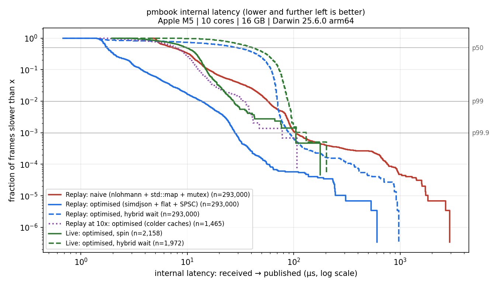

# pmbook

A C++20 engine that connects to Polymarket's public market-data WebSocket, keeps an exact copy of the order book for each subscribed outcome token, records every frame so any session can be replayed offline, measures its own processing latency, and streams top-of-book updates to a separate Python market-making strategy.

It is market data only: no orders, no wallets, no keys, no accounts.



## Results

Apple M5, 10 cores, 16 GB, macOS 26.6.2, Homebrew clang 23.1.4, `-O3` + LTO. Every number below comes from a file in [`results/`](results/), produced by the code in this repo. [`results/m8_summary.md`](results/m8_summary.md) is generated from those files by `tools/plot_latency.py`.

**Internal latency**: from the moment a frame is handed to us by the WebSocket library to the moment the order book is updated and its PMBook line is published.

| | p50 | p90 | p99 | p99.9 | max |
|---|---:|---:|---:|---:|---:|
| Naive: nlohmann::json + `std::map` book + `std::mutex` queue | 7.3 µs | 15.9 µs | 57.3 µs | 103.4 µs | 2,915 µs |
| **Optimised**: simdjson + flat-array book + lock-free SPSC queue | **1.8 µs** | **3.7 µs** | **13.6 µs** | **28.2 µs** | **605 µs** |
| Live session, optimised, 10 min, 6 tokens, busy-spin | 9.7 µs | 15.1 µs | 27.1 µs | 104.4 µs | 177 µs |

The naive and optimised rows use the same recorded data: the 12-minute sample in `data/sample/`, replayed 200 times with the recorded gaps between frames shrunk 1000× (293,000 measured frames). Both produce identical order books, checked against the live run that recorded the data.

**Throughput** (one thread, no pacing): 660k frames/s optimised vs 214k frames/s naive (3.1×).

**Components** (Google Benchmark / custom harness, same machine):

| | Optimised | Baseline |
|---|---:|---:|
| Book: update one level + read best bid/ask | 4.9 ns (flat array) | 40.6 ns (`std::map`) |
| Book: replace with a 30+30-level snapshot | 175 ns | 1,451 ns |
| Queue: throughput, 2 threads | 200 M items/s (SPSC) | 38 M items/s (mutex) |
| Queue: round trip p50 / p99.9 | 125 ns / 375 ns | 3,583 ns / 34,625 ns |

### What is and isn't measured

- **Measured**: time inside this process, from the network thread's timestamp (taken as the first thing when a frame arrives) through the lock-free queue, parsing, the book update, and formatting the output line.
- **Not measured**: network time to and from Polymarket, TLS decryption and WebSocket framing inside IXWebSocket (these happen before our timestamp), Polymarket's own processing, and anything the strategy does. `ts_exchange_ms` is the exchange's clock, so comparing it with ours would mix in clock offset. This project makes no claims about network or exchange latency.
- Replay runs format every line fully and then discard the bytes. Writing to a stdout pipe adds about 1 µs (measured). Live runs write to a real pipe read by `examples/consume.py`.
- Live is slower than fast replay because messages arrive seconds apart and the CPU caches go cold in between: replaying the same data at only 10× raised service time from 1.5 µs to 3.7 µs. `--wait hybrid` (the default, which naps when idle) adds about 30 µs at p50. `--wait spin` avoids that but keeps one core at 100%.
- macOS doesn't allow pinning threads to cores, and its clock ticks every 41 ns, so the smallest numbers are a few clock ticks. A first live spin run overlapped with compiling and showed 2.5 ms stalls, so it was discarded and re-run on an idle machine.

## How it works

```
 Polymarket  wss://ws-subscriptions-clob.polymarket.com/ws/market
     │  TLS WebSocket, JSON text frames; PING every 10 s
     ▼
┌──────────────────────┐  stamps each frame (steady_clock ns), copies it into
│ feed/  network thread│  a reused slot. Reconnects with exponential backoff +
└──────────┬───────────┘  jitter, detects silent connections, resubscribes
           │ lock-free SPSC ring buffer (acquire/release, cache-line padded)
           ▼
┌──────────────────────┐
│ processing thread    │  parse/   simdjson On-Demand → fixed-point structs
│ (FrameProcessor)     │  book/    one slot per 0.0001 price + occupancy bitmap;
│                      │           checks every update against the exchange's
│                      │           best bid/ask, flags resync on mismatch
│                      │  publish/ PMBook v1 lines → stdout or TCP :9100 ──► Python strategy
│                      │  record/  gzip JSONL, rotated hourly (after publishing)
└──────────────────────┘
           ▲
 replay/   reads recordings back through the same FrameProcessor
```

Design decisions worth knowing:

- **Fixed-point numbers.** Prices are stored as integers in units of 0.0001, sizes in units of 0.000001. Floats can't represent 0.1 exactly, so equality checks and array indexing on float prices break. A price string with more precision than we can hold is rejected, never rounded.
- **Flat-array book.** Polymarket prices lie between 0 and 1, so there are only 10,001 possible prices. Each side is an array indexed by price, plus a bitmap so finding the next best level is a few `countl_zero` instructions. It's checked against a `std::map` reference on 1,000,000 random updates.
- **No sequence numbers on this feed.** Instead, every `price_change` carries the exchange's best bid/ask after the change, and we compare ours after every update. Across all recorded and live sessions, that's 0 mismatches.
- **Deterministic.** Book state is a pure function of the frame sequence: no clocks, no connection events. Replaying the shipped sample reproduces the live run's final books exactly (per-asset state hashes), and the test suite checks this.
- **Raw frames are recorded, not parsed output,** so recordings can be replayed through new versions of the parser and book.

## Correctness

106 tests (GoogleTest), run by `make check` in three builds: AddressSanitizer + UndefinedBehaviorSanitizer, ThreadSanitizer, and release. Zero compiler warnings in our code (`-Wall -Wextra -Wpedantic -Wconversion -Wshadow`, `-Werror`).

- Parser: the official docs examples, real captured frames cross-checked field by field against nlohmann, 12 malformed inputs, every truncated prefix of valid messages.
- Book: typed tests on both books; 1,000,000 random updates where flat array == `std::map` after every step. A deliberately planted off-by-one bug fails it on the first update.
- Feed: a fake exchange on localhost tests heartbeat, server drops (identical resubscribe), silent connections and backoff timing; it passes 10× in a row under TSan.
- SPSC queue: stress tests with tiny capacities. With acquire/release replaced by relaxed, TSan flags all 5 stress tests, and a plain `-O3` build on Apple Silicon returns wrong values in 4 of 5.
- End to end: the replayed sample is published and validated by the Python consumer against every rule in [`CONTRACT.md`](CONTRACT.md).
- Live: a 12-minute recording with 3 forced disconnects plus 1 real drop gave 0 parse errors, 0 best-bid/ask mismatches and 0 crossed books, and rotated files across an hour boundary.

## Build

Requirements: CMake ≥ 3.24, Ninja, OpenSSL, zlib, Python 3. All C++ dependencies (simdjson, IXWebSocket, nlohmann/json, GoogleTest, Google Benchmark) are fetched by CMake.

```bash
# macOS (Apple Silicon)
brew install cmake ninja openssl@3 llvm clang-format
make release        # -O3 + LTO      -> build/release/pmbook
make test           # ASan + UBSan build, all tests
make check          # debug, tsan and release builds, all tests, format check
```

On macOS the build uses Homebrew LLVM automatically, because Xcode 16.0's sanitizer runtimes crash at startup on macOS 26 (`-DPM_USE_APPLE_CLANG=ON` opts out).

Linux (Ubuntu: `apt install cmake ninja-build libssl-dev zlib1g-dev`) is supported by the code and by [`.github/workflows/ci.yml`](.github/workflows/ci.yml) (GCC and Clang), but **has not been built yet**: no Linux machine was available, and CI runs only once the repo is pushed.

## Run

```bash
# 1. Pick liquid markets (prints token IDs)
python3 tools/list_markets.py --limit 3

# 2. Live: books -> Python consumer, recording to data/recordings/
./build/release/pmbook live --asset <token_id> --asset <token_id> | python3 examples/consume.py

#    or over TCP (127.0.0.1:9100)
./build/release/pmbook live --asset <token_id> --publish tcp &
python3 examples/consume.py --tcp 127.0.0.1:9100

# 3. Replay offline (no internet needed): the shipped sample must reproduce the live run
make replay-sample
./build/release/pmbook replay --speed 1 --publish stdout data/sample/pm_*.jsonl.gz | python3 examples/consume.py

# 4. Benchmarks (on an idle machine), then the chart and table
sh tools/run_benchmarks.sh && python3 tools/plot_latency.py
```

Useful `live` flags: `--duration SEC`, `--chaos-disconnect SEC` (forces drops to test reconnects), `--wait spin|hybrid`, `--depth N`, `--latency-out FILE`, `--no-record`. Stats and logs go to stderr; stdout carries only the PMBook stream.

## Repository layout

| Path | What |
|---|---|
| `src/feed/` | WebSocket client: heartbeat, backoff, stale detection, resubscribe |
| `src/parse/` | Fixed-point parsing; simdjson parser into compact structs |
| `src/book/` | Flat-array book, `std::map` reference, per-asset manager with consistency checks |
| `src/queue/` | Lock-free SPSC queue, mutex baseline, network→processing pipeline |
| `src/record/`, `src/replay/` | gzip JSONL recorder/reader, paced replay |
| `src/publish/` | PMBook v1 publisher, stdout and TCP sinks |
| `src/naive/` | nlohmann-based parser for the baseline |
| `src/app/` | The shared `FrameProcessor`, run summaries |
| `bench/`, `results/` | Benchmarks and their saved output |
| `examples/consume.py` | Reference consumer and contract validator |
| `learn/` | Ten one-page lessons on everything above, plus a glossary |

## CV bullets

Each uses only numbers from `results/` or logged runs, with the source given underneath.

1. **Built a low-latency C++20 market-data engine for Polymarket's live WebSocket feed** (simdjson parsing, fixed-point flat-array order book, lock-free SPSC queue), cutting internal latency about 4× versus a naive nlohmann/`std::map`/mutex baseline: p50 1.8 µs vs 7.3 µs, p99.9 28 µs vs 103 µs, over 293k replayed frames.
   *Source: `results/m8_replay_*_spin.json`, Apple M5.*

2. **Designed deterministic record/replay and live consistency checks**: a 12-minute live session (2,902 book updates, 6 tokens) replays to identical order books (matching per-asset state hashes), and every live update matched the exchange's best bid/ask (0 mismatches), with a 106-test suite clean under ASan, UBSan and ThreadSanitizer.
   *Source: `data/sample/live_summary.json`, `make replay-sample`, `make check`.*

3. **Implemented and stress-tested a lock-free SPSC ring buffer** (acquire/release ordering, cache-line padding) with 5× the throughput of a mutex queue (200M vs 38M items/s) and a 125 ns vs 3.6 µs round-trip p50. Showed that the relaxed-ordering bug corrupts data on ARM and is caught by ThreadSanitizer.
   *Source: `results/m6_queue_bench.json`, `learn/07`.*

## Learn

[`learn/00-START-HERE.md`](learn/00-START-HERE.md) indexes ten one-page lessons (order books, fixed point, cache-friendly data structures, reconnects, determinism, memory ordering, protocols, latency measurement, interview prep), each ending with interview questions.
